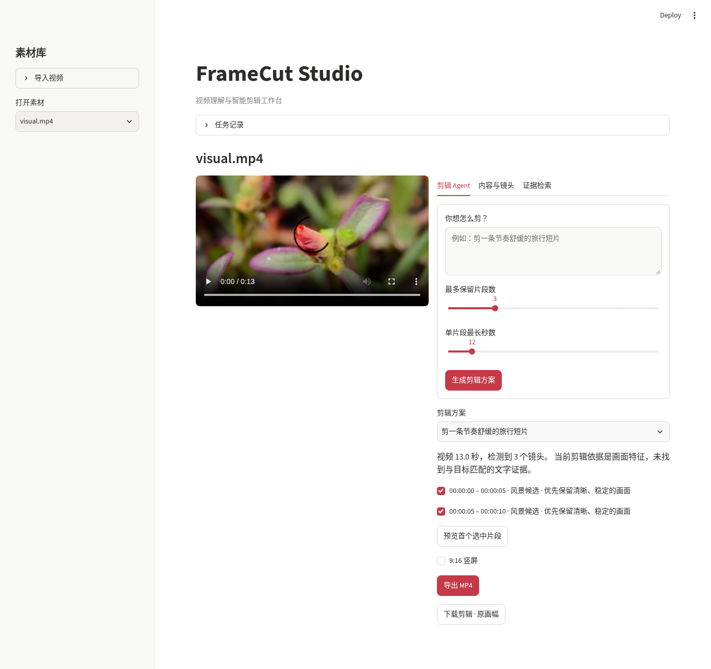
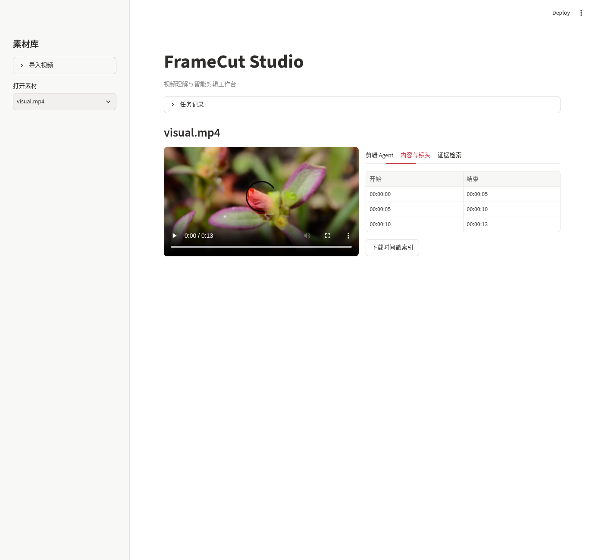
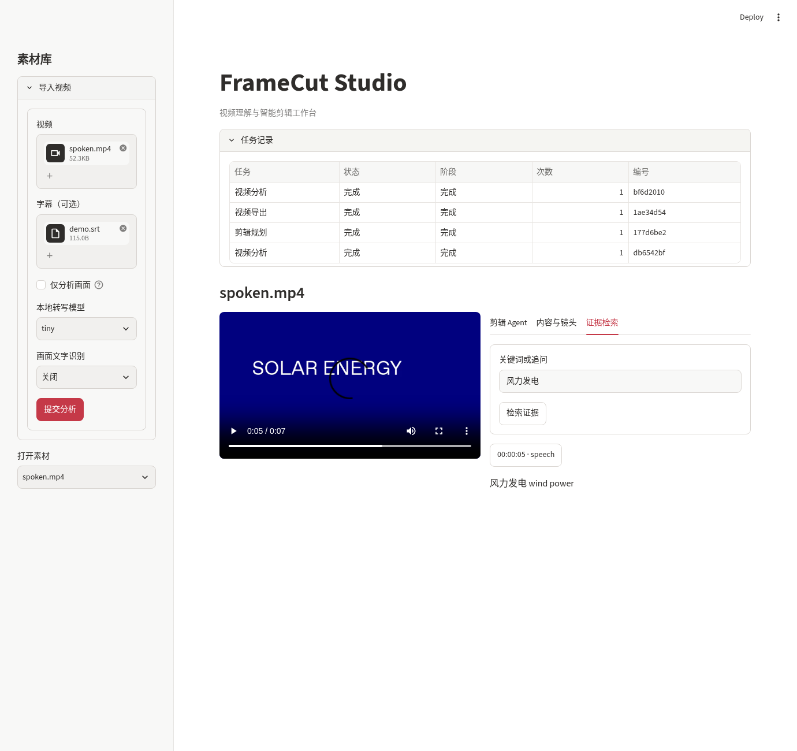
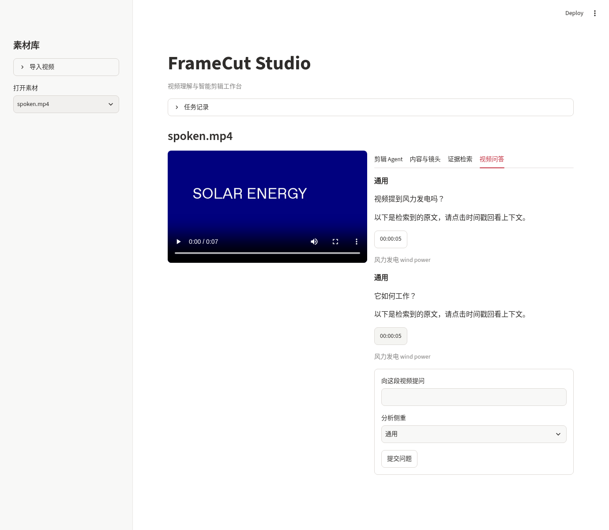
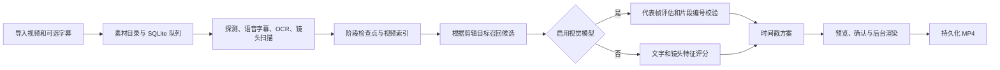

# FrameCut Studio

FrameCut Studio 是一个把**视频理解、剪辑规划和 MP4 导出**串起来的本地视频 Agent。它从同一份视频建立时间戳索引，读取语音、字幕和画面证据，再按你的剪辑目标提出可以回看片段来源的方案。

## 使用流程

1. 上传视频，可选导入 SRT / WebVTT。Agent 会抽样分析镜头，并在本机用 faster-whisper 转写语音。风景或无旁白素材可以勾选「仅分析画面」，跳过自动转写。也可用 Tesseract 识别画面文字。
2. 在「剪辑 Agent」描述目标，例如「保留风力发电的讲解，穿插稳定的镜头」或「剪一条节奏舒缓的旅行短片」。Agent 结合文字证据和镜头特征产生剪辑方案，也可接入视觉模型识别画面内容。
3. 核对内容摘要、时间戳和选段依据，预览、勾选后导出原画幅或 9:16 H.264 MP4。可在「内容与镜头」浏览索引，在「证据检索」点击时间戳回看原片。

## 本地启动

需要 Python 3.10+ 与带 libx264 的 FFmpeg（包括 ffprobe）。OCR 可选，需要 Tesseract 和对应语言包（简体中文为 `chi_sim`）。首次转写会下载模型权重。Web 工作台运行在本机，上传和下载占用内存，大文件可直接走命令行。

```bash
python -m venv .venv
source .venv/bin/activate
python -m pip install -r requirements.txt
streamlit run studio.py
```

## 画面语义理解

默认可离线按文字证据、镜头稳定性、细节和变化程度做初剪。要按「保留海边和日落」等具体画面内容选段，可接入支持图文输入的 OpenAI 兼容模型，例如本机 Ollama 的 `qwen2.5vl:3b`。

```bash
ollama pull qwen2.5vl:3b
export FRAMECUT_VISION_MODEL=qwen2.5vl:3b
export FRAMECUT_API_BASE=http://127.0.0.1:11434/v1
streamlit run studio.py
```

如模型服务需要认证，可通过环境变量 `FRAMECUT_API_KEY` 设置密钥。开启视觉模型后，候选片段的代表帧和相关文字会发送到配置的服务。模型只能选择已存在的片段编号，实际剪切边界来自本地索引。视觉模型检查的是抽样后的代表帧，镜头边界精度取决于采样频率，且很短的画面事件可能遗漏。

## 视频问答

同一份素材支持连续提问并保留历史。检索使用本次问题和最近两次提问，结果会附可点击的原片时间戳。无需模型时直接展示原文证据。设置 `FRAMECUT_TEXT_MODEL` 可用同一 OpenAI 兼容 API 生成带引文的回答，并按通用、学习、审查或创作侧重组织结果。模型未给出有效引用时会退回原文。

## 命令行

```bash
python framecut.py index lecture.mp4 lecture.json --visual --subtitles lecture.srt
python framecut.py edit lecture.json "保留风力发电讲解" lecture.mp4 highlights.mp4 --count 3

python framecut.py index trip.mp4 trip.json --visual --skip-speech
python framecut.py edit trip.json "选出适合旅行短片的稳定镜头" trip.mp4 trip-reel.mp4 --vertical
python framecut.py edit trip.json "保留海边和日落" trip.mp4 sunset.mp4 --vision --vertical
```

用 `--plan-only` 只打印剪辑方案。移除 `--subtitles` 可自动转写，`--model small` 可选更大的模型。可用 `--ocr chi_sim+eng --interval 30` 定时识别画面文字。独立的 `chapters`、`search`、`cut` 和 `highlights` 命令可用于脚本集成。

## 项目演示

以下截图来自运行中的 FrameCut 工作台。素材包含实拍花卉、运动测试画面和黑场。导入时选择「仅分析画面」，提交目标「剪一条节奏舒缓的旅行短片」。工作台生成带时间范围的片段候选，导出选中的镜头，重新打开页面仍可下载结果。

| 剪辑方案、选段与下载 | 内容索引与镜头时间线 |
| --- | --- |
|  |  |




可用仓库中的样片复现演示。 [演示输入](docs/demo/demo-input.mp4) · [时间戳索引](docs/demo/demo-index.json) · [导出成片](docs/demo/demo-output.mp4)演示里的实拍素材来自 [MDN 的 CC0 花卉视频](https://interactive-examples.mdn.mozilla.net/media/cc0-videos/flower.mp4)。

## 核心能力

| 环节 | 工作台行为 |
| --- | --- |
| 导入与排队 | 文件按内容哈希保存。相同素材和设置的任务复用同一编号，后台工作线程串行消费，网页可以切换到其他素材。 |
| 时间戳索引 | 分段转写或导入字幕，可选 OCR；画面扫描提取镜头边界、曝光、细节及变化幅度。章节摘录和检索结果可回看原片。 |
| Agent 剪辑 | 给定一个编辑目标，结合文字与镜头特征提案。配置视觉服务后可基于代表帧选择候选；选段只能引用本地已存在的时间范围。 |
| 预览与交付 | 勾选片段后后台渲染，支持原画幅和保留完整画面的 9:16 竖屏。MP4 和计划保存在素材工作区。 |
| 任务恢复 | SQLite 持久化任务和状态。工作进程重启时重新排队未完成任务，重试复用已落盘的分析阶段。任务记录显示状态、阶段和尝试次数。 |

## 部署与运行

### 容器

```bash
docker compose up --build
# 在浏览器打开 http://localhost:8501
```

Compose 将素材、任务库、检查点、成片和转写模型缓存放在 `framecut` 数据卷里。备份时先停服务，再备份整个卷。本机运行时可设置 `FRAMECUT_WORKSPACE` 指向持久化目录，默认是项目下的 `.framecut/`。工作线程使用 Linux / macOS 的文件锁，Windows 可使用容器或 WSL。

### 故障处理

- 分析或导出失败时，打开对应素材或方案查看阶段错误，修复依赖或模型服务后点击「重试任务」。已完成的阶段会跳过。
- OCR 报语言包缺失时，安装 Tesseract 对应语言，或用「关闭」重新提交。容器包含英语和简体中文包。
- 容器内通过 `host.docker.internal` 访问宿主机 Ollama 时，宿主机服务需监听容器可访问的地址。默认 Compose 只把工作台发布到本机回环地址。
- 首次使用语音转写需要联网下载模型。处理无旁白视频时可勾选「仅分析画面」。

## 工程边界

目前定位为单机工作台。数据保存在本机文件系统和 SQLite，单工作线程按提交顺序处理；工作台允许同一实例里的用户访问同一素材库。浏览器上传受 Streamlit 上限和内存限制，尚未实现分片续传、账号隔离、分布式队列、配额和多租户部署。文字证据使用关键词检索，尚未接入向量召回或多角色审阅。转写每五分钟提交检查点。OCR 和画面扫描按整项保存，执行中断后会重新扫描当前阶段。

## 系统流程



## 代码结构与验证

| 路径 | 职责 |
| --- | --- |
| `studio.py` | 素材库、任务状态、证据浏览、剪辑审核与下载 |
| `jobs.py` | SQLite 队列、数据落盘、恢复与阶段检查点 |
| `agent.py` | 按目标规划、可选视觉模型、片段校验 |
| `framecut.py`、`visual.py` | FFmpeg、ASR、OCR、检索、镜头分析和命令行 |
| `tests/` | 任务复用、检查点重试、规划、导出解码验证 |

```bash
python -m unittest discover -s tests -v
```

## 许可证

[MIT](LICENSE)
