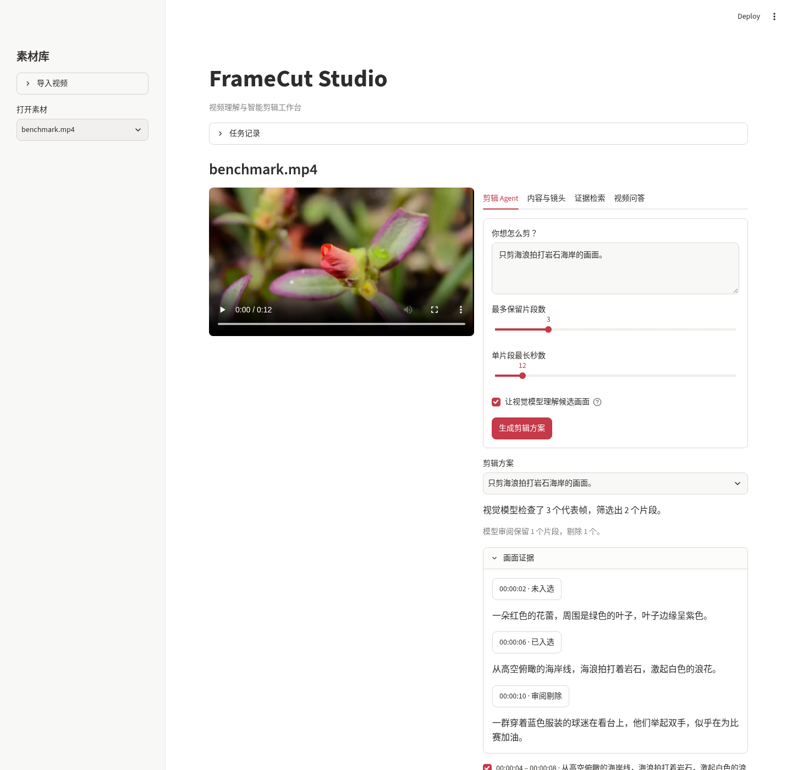

# 本地模型与效果复现

FrameCut 的视觉剪辑先对候选代表帧生成独立画面描述，再根据用户目标筛选已存在的镜头编号。画面描述带原片时间戳，同一份素材的后续目标可以复用已处理的代表帧。遇到重复画面会合并推理，批次缺少有效编号时会逐帧补查。筛选后会再次审阅入选片段，可通过 FRAMECUT_REVIEW_MODEL 指定审阅模型。模型未找到匹配时，剪辑方案为空。选段范围由本地时间轴校验。

## 启动实测模型

安装 [llama.cpp](https://github.com/ggml-org/llama.cpp/releases/tag/b12521) 的 CPU 发行包。下载 [Qwen3-VL-2B-Instruct Q4_K_M 及 F16 视觉投影](https://huggingface.co/unsloth/Qwen3-VL-2B-Instruct-GGUF/tree/8dcb98e52a1d1d02dce9249e5ab15bae8121c666)，选用下面文件名并在一个终端运行：

```bash
llama-server --model Qwen3-VL-2B-Instruct-Q4_K_M.gguf \
  --mmproj mmproj-F16.gguf --alias qwen3-vl-2b \
  --host 127.0.0.1 --port 8510 --threads 2 --threads-batch 2 \
  --ctx-size 4096 --parallel 1 --temp 0
```

中文语义检索可使用 [BGE-small-zh-v1.5 Q8_0](https://huggingface.co/CompendiumLabs/bge-small-zh-v1.5-gguf)，在另一个终端运行：

```bash
llama-server --model bge-small-zh-v1.5-q8_0.gguf --alias bge-small-zh \
  --host 127.0.0.1 --port 8511 --threads 2 --embedding --pooling cls
```

在工作台和评估命令所在的终端设置环境变量：

```bash
export FRAMECUT_API_BASE=http://127.0.0.1:8510/v1
export FRAMECUT_VISION_MODEL=qwen3-vl-2b
export FRAMECUT_EMBEDDING_API_BASE=http://127.0.0.1:8511/v1
export FRAMECUT_EMBEDDING_MODEL=bge-small-zh
streamlit run studio.py
```

上传无旁白素材时可勾选「仅分析画面」。生成剪辑方案时保持「让视觉模型理解候选画面」开启。展开「画面证据」可查看入选和未入选的代表帧描述，点击时间回看原片。

## 复现测试

```bash
python scripts/evaluate_vision.py ./evaluation
python scripts/evaluate_retrieval.py
```

视觉测试从 [MDN 花朵视频](https://interactive-examples.mdn.mozilla.net/media/cc0-videos/flower.mp4)、[Pexels 岩岸素材](https://www.pexels.com/video/1409899/) 和 [Pexels 看台素材](https://www.pexels.com/video/3192307/) 各取 4 秒，组成无声测试片。三个存在目标各要求选一个片段，预测区间与人工标注区间的交并比至少为 0.75 才算通过。缺失目标包括雪地红车、海上帆船和海滩奔跑的狗，均要求返回空方案。脚本写入 JSON 报告，对生成的 MP4 逐个进行 FFmpeg 解码检查。语义检索脚本要求在关键词无命中的情况下，把三个改写查询分别命中正确时间戳。

## 实测结果

| 请求 | 人工标注 | 模型实际导出 |
| --- | --- | --- |
| 花蕾与绿叶特写 | 0–4 秒 | 0–4 秒 |
| 海浪拍打岩岸 | 4–8 秒 | 4–8 秒 |
| 举手欢呼的人群 | 8–12 秒 | 8–12 秒 |
| 雪地红车、海上帆船、海滩奔跑的狗 | 各为空 | 各为空 |

Qwen3-VL 在此样片上通过 6/6 个用例，纯画面特征初剪通过 1/6。三个导出文件均通过 FFmpeg 解码。BGE 在三条中文改写查询上全部命中正确时间戳，关键词检索均无命中。 [视觉评估原始结果](evaluation/vision.json) · [向量评估原始结果](evaluation/retrieval.json)

另一次 80 秒测试由 20 个四秒片段组成，花卉与人群交替，第 17 个片段替换为唯一的海浪镜头。Agent 检查了 12 个代表帧，在 66 秒处找到海浪，导出 64–68 秒并通过解码。这个测试覆盖了重复镜头和靠近片尾的目标。

工作台的实际海浪案例启用了规划、视觉与审阅。规划生成了「海浪」和「岩石海岸」两条检索词。第一次筛选将海浪和人群列为候选，第二次审阅剔除了人群，最终只导出 4–8 秒。 [工作台计划及审阅结果](evaluation/web-plan.json)



该测试覆盖三个短镜头和三个缺失目标。视觉模式抽样查看候选代表帧，快速动作、短时出现的对象、细微属性和长视频中的未采样镜头可能遗漏。模型描述来自图像，剪辑前可在工作台核对原片。更大的评估集仍需要包含长视频、重复出现的目标与相似干扰镜头。
